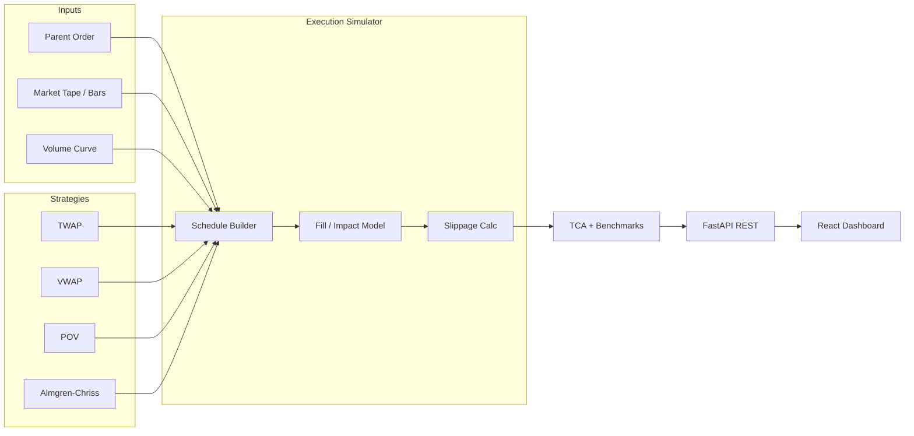
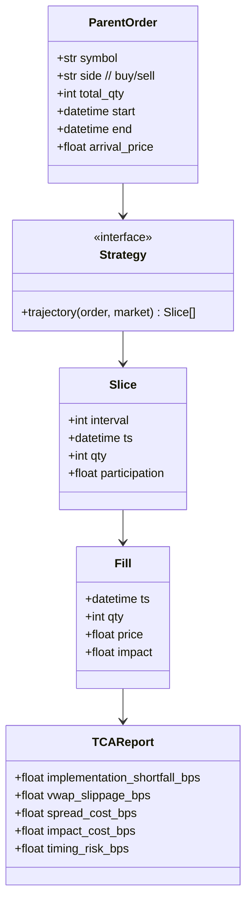

# Trade Execution Simulator — Project Plan

A professional **execution-algorithm** simulator that models how a large parent
order is sliced into child orders and worked through the market over time. It
implements **TWAP**, **VWAP**, and **POV** schedules plus **Almgren–Chriss**
optimal execution, applies a **market-impact** model to each fill, measures
**slippage** and **implementation shortfall**, and produces a full
**transaction-cost analysis (TCA)** against standard benchmarks.

> **Disclaimer:** This is a simulation and analytics tool for studying execution
> strategy and cost. It does not connect to brokers or place live orders.

---

## 1. Goals & Scope

| Goal | Description |
|------|-------------|
| Faithful | Reproduce how TWAP/VWAP/POV/AC schedules behave and what they cost. |
| Cost-aware | Decompose cost into spread, temporary impact, permanent impact, and timing risk. |
| Benchmarked | Score every run against arrival, interval-VWAP, TWAP, and close. |
| Comparable | Run multiple strategies on the same tape and rank them on cost vs risk. |

**Out of scope (v1):** live order routing, real broker/FIX connectivity, dark-pool
microstructure, multi-asset portfolio execution, queue-position modeling at the
tick level (use bar/volume-curve granularity).

---

## 2. Architecture



**Pattern:** A strategy produces a **trajectory** (shares to trade per interval).
The **simulator** executes that trajectory against a market tape, applying an
impact model to compute fill prices. A **TCA** layer turns fills into costs and
benchmark comparisons. All quantitative logic is framework-free (`core/`) so it
runs in notebooks, a CLI, or the API.

---

## 3. Tech Stack

| Layer | Choice | Purpose |
|-------|--------|---------|
| Language | Python 3.11+ | Strategies + simulation + TCA |
| Data | pandas, NumPy | Bars, volume curves, vectorized cost math |
| Optimization | SciPy | Almgren–Chriss params, curve fitting |
| API | FastAPI + Uvicorn | REST endpoints, OpenAPI docs |
| Validation | Pydantic v2 | Order/strategy/result schemas |
| Market data | CSV / Parquet loaders (yfinance/Tiingo optional) | Historical bars + volume |
| Frontend | React (Vite + TypeScript) | Dashboard |
| Charts | Plotly.js | Schedules, fills, cost waterfalls, frontier |
| Testing | pytest, hypothesis | Unit + property-based |
| Tooling | ruff, black, mypy | Lint, format, type-check |

---

## 4. Repository Structure

```
trade-execution-simulator/
├── PLAN.md                       # this file
├── README.md
├── backend/
│   ├── pyproject.toml
│   ├── app/
│   │   ├── main.py               # FastAPI app + routers
│   │   ├── schemas/              # Pydantic DTOs
│   │   │   ├── order.py
│   │   │   ├── strategy.py
│   │   │   └── result.py
│   │   ├── api/
│   │   │   ├── routes_simulate.py
│   │   │   ├── routes_strategies.py
│   │   │   ├── routes_tca.py
│   │   │   └── routes_compare.py
│   │   ├── data/
│   │   │   ├── loaders.py        # bars + volume curve
│   │   │   └── volume_profile.py # U-shaped intraday profile
│   │   └── core/                # PURE execution math, no FastAPI
│   │       ├── order.py          # parent order model
│   │       ├── impact.py         # temporary + permanent impact
│   │       ├── strategies/
│   │       │   ├── base.py       # Strategy interface → trajectory
│   │       │   ├── twap.py
│   │       │   ├── vwap.py
│   │       │   ├── pov.py
│   │       │   └── almgren_chriss.py
│   │       ├── simulator.py      # execute trajectory vs tape
│   │       ├── slippage.py       # vs arrival / benchmarks
│   │       ├── benchmarks.py     # arrival, VWAP, TWAP, close
│   │       └── tca.py            # cost decomposition + report
│   └── tests/
│       ├── test_twap.py
│       ├── test_vwap.py
│       ├── test_pov.py
│       ├── test_almgren_chriss.py
│       ├── test_impact.py
│       ├── test_simulator.py
│       └── test_tca.py
└── frontend/
    ├── package.json
    └── src/
        ├── App.tsx
        ├── api/client.ts
        ├── components/
        │   ├── OrderForm.tsx
        │   ├── ScheduleChart.tsx       # planned vs executed shares
        │   ├── FillPriceChart.tsx      # fills over price tape
        │   ├── CostWaterfall.tsx       # IS decomposition
        │   ├── EfficientFrontier.tsx   # AC cost vs risk
        │   └── StrategyCompare.tsx
        └── types/api.ts
```

---

## 5. Domain Model



---

## 6. The Math (Execution Engine)

Trade a parent order of $X$ shares over $N$ intervals. Let $x_j$ be shares
executed in interval $j$ (so $\sum_j x_j = X$) and $n_j = x_j / \tau$ the trading
rate over interval length $\tau$.

### 6.1 TWAP

Equal slices across time:

$$x_j = \frac{X}{N} \quad \forall j$$

### 6.2 VWAP

Slice proportional to the (forecast) market volume profile $V_j$ — typically the
intraday **U-shape** (heavy at open/close):

$$x_j = X \cdot \frac{V_j}{\sum_{k=1}^{N} V_k}$$

The aim is to match the day's volume-weighted average price.

### 6.3 POV (percentage of volume)

Track a target participation rate $\alpha$ of realized market volume $V_j$:

$$x_j = \alpha\, V_j, \qquad \text{(clip cumulative to } X\text{)}$$

### 6.4 Market-impact model

Each child order pays **temporary** impact (transient, depends on rate) and the
market absorbs **permanent** impact (lasting, depends on size). Using the
Almgren–Chriss linear forms with volatility $\sigma$:

- Permanent: $g(n_j) = \gamma\, x_j$ — shifts the reference price persistently.
- Temporary: $h(n_j) = \epsilon\,\mathrm{sgn}(x_j) + \eta\, n_j$ — paid only on
  that slice (half-spread $\epsilon$ plus rate term $\eta n_j$).

Execution price for slice $j$ (buy):

$$\tilde P_j = P_j + \underbrace{\textstyle\sum_{k\le j}\gamma x_k}_{\text{permanent}} + \underbrace{h(n_j)}_{\text{temporary}}, \qquad
P_j = P_{j-1} + \sigma\sqrt{\tau}\,\xi_j$$

where $\xi_j \sim \mathcal{N}(0,1)$ is the random mid-price innovation.

### 6.5 Almgren–Chriss optimal execution

Minimize a mean–variance objective over the trajectory — expected cost plus
risk-aversion $\lambda$ times variance:

$$\min_{x_1,\dots,x_N}\; \mathbb{E}[C] + \lambda\, \mathrm{Var}[C]$$

with (for the linear model)

$$\mathbb{E}[C] = \tfrac{1}{2}\gamma X^2 + \epsilon\!\sum_j |x_j| + \frac{\eta}{\tau}\sum_j x_j^2, \qquad
\mathrm{Var}[C] = \sigma^2 \sum_j \tau\, X_j^2$$

where $X_j = \sum_{k>j} x_k$ is the **remaining** inventory. The closed-form
optimal holdings trajectory is hyperbolic:

$$X_j = X\,\frac{\sinh\!\big(\kappa (T - t_j)\big)}{\sinh(\kappa T)}, \qquad
\kappa \approx \sqrt{\frac{\lambda \sigma^2}{\eta}}$$

- $\lambda \to 0$ (risk-neutral) ⇒ trajectory → TWAP (trade slowly, minimize impact).
- $\lambda$ large (risk-averse) ⇒ front-loaded (trade fast, cut timing risk).

Sweeping $\lambda$ traces the **efficient frontier** of expected cost vs variance.

### 6.6 Slippage & benchmarks

Average executed price $\bar P = \frac{\sum_j x_j \tilde P_j}{X}$. Slippage (bps,
sign-adjusted for side) against each benchmark $B$:

$$\text{slip}_B = 10^4 \cdot \frac{\bar P - B}{B}\cdot \mathrm{side}$$

| Benchmark | Definition |
|-----------|------------|
| Arrival | mid-price at decision time $P_0$ |
| Interval VWAP | $\sum_j V_j P_j / \sum_j V_j$ over the window |
| TWAP | simple mean of interval prices |
| Close | last price of the window |

### 6.7 Implementation shortfall (TCA decomposition)

Total cost vs the arrival (decision) price, decomposed into attributable parts:

$$\underbrace{\text{IS}}_{\bar P - P_0} = \underbrace{\text{spread cost}}_{\epsilon\text{-term}} + \underbrace{\text{temporary impact}}_{\eta\text{-term}} + \underbrace{\text{permanent impact}}_{\gamma\text{-term}} + \underbrace{\text{timing / drift}}_{\sigma\text{-term}}$$

reported in basis points so strategies are directly comparable.

---

## 7. Simulation Loop

1. Load market tape (bars) + volume profile for the order window.
2. Strategy emits a **trajectory** $\{x_j\}$ (static) or a **policy**
   (rate adapts to realized volume for POV).
3. For each interval: draw the price innovation, apply permanent + temporary
   impact, record the **fill** $\tilde P_j$, update remaining inventory.
4. Aggregate fills → average price, benchmarks, slippage.
5. Run TCA decomposition → `TCAReport`.
6. Optionally Monte-Carlo over price paths to report cost **distributions**
   (mean, p5/p95) rather than a single number.

---

## 8. API Design (REST)

| Method | Endpoint | Body → Returns |
|--------|----------|----------------|
| GET  | `/api/strategies` | available strategies + params |
| POST | `/api/simulate` | order + strategy + market → fills + TCA |
| POST | `/api/tca` | fills + benchmarks → cost decomposition |
| POST | `/api/compare` | order + N strategies → ranked TCA table |
| POST | `/api/frontier` | order + λ-grid → Almgren–Chriss cost/risk frontier |
| POST | `/api/montecarlo` | order + strategy + paths → cost distribution |

FastAPI auto-generates Swagger docs at `/docs`.

---

## 9. Frontend Features

- **Order Form** — symbol, side, quantity, window, strategy + parameters.
- **Schedule Chart** — planned vs executed shares per interval (with volume curve).
- **Fill Price Chart** — child fills overlaid on the price tape and benchmarks.
- **Cost Waterfall** — implementation-shortfall decomposition in bps.
- **Efficient Frontier** — Almgren–Chriss expected cost vs variance as $\lambda$ varies.
- **Strategy Compare** — side-by-side TCA table ranking TWAP/VWAP/POV/AC.

---

## 10. Validation & Testing

- **TWAP/VWAP identities** — equal slices for TWAP; slice ratios equal volume
  ratios for VWAP (exact, deterministic).
- **Conservation** — $\sum_j x_j = X$ for every strategy and rounding scheme.
- **Impact sanity** — zero impact params ⇒ fills equal mid; larger $\eta$ ⇒
  monotonically worse slippage.
- **AC limits** — $\lambda \to 0$ recovers TWAP; large $\lambda$ front-loads the
  trajectory (tested on the closed form).
- **TCA reconciliation** — cost components sum to total implementation shortfall.
- **Property tests** — slippage sign flips correctly between buy and sell.

---

## 11. Roadmap

| Phase | Deliverable |
|-------|-------------|
| 0 | Repo, schemas, market/volume loaders |
| 1 | TWAP + simulator + slippage vs arrival |
| 2 | Volume profile + VWAP + POV |
| 3 | Temporary/permanent impact model |
| 4 | Benchmarks + implementation-shortfall TCA |
| 5 | Almgren–Chriss optimal trajectory + efficient frontier |
| 6 | Monte-Carlo cost distributions + strategy compare |
| 7 | React dashboard (schedule, fills, waterfall, frontier) |
| 8 | Example datasets, CLI, README + demo |

---

## 12. Resume Bullet

> Built a **trade execution simulator** implementing TWAP, VWAP, POV, and
> **Almgren–Chriss** optimal execution with a temporary/permanent **market-impact**
> model — computing slippage, **implementation-shortfall** decomposition, and a
> cost-vs-risk **efficient frontier**, with benchmark TCA against arrival, VWAP,
> TWAP, and close.
