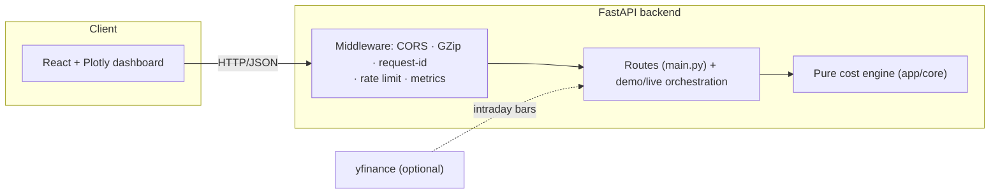
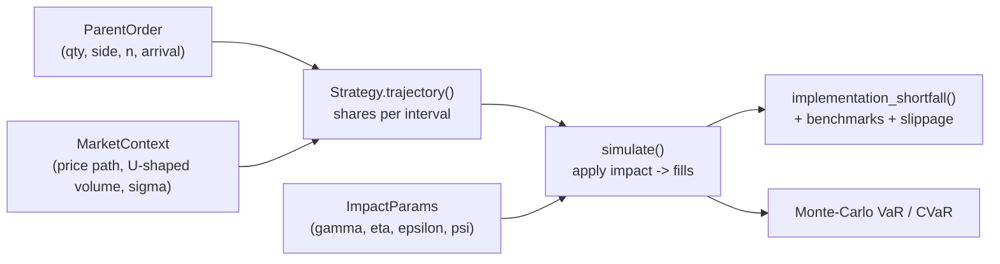

# Architecture

This document explains how the Trade Execution Simulator is built: the pure
execution-cost engine, the market-impact model (now including the non-linear
square-root law), the execution algorithms, the TCA/frontier analytics, and the
API/observability layers around them.

> For *what* it does and how to run it, see the [README](../README.md); for the
> derivations, see [PLAN.md](../PLAN.md). This document is the *how and why*.

---

## 1. Design goals

1. **A pure cost engine.** Everything numerical lives in `app/core/` as plain
   NumPy modules with **no FastAPI and no I/O**. The API, the dashboard, the live
   adapter, and the tests all call the same functions.
2. **Exact, reconciling TCA.** The implementation-shortfall decomposition
   (spread + temporary + permanent + timing) sums to the realised shortfall *by
   construction*, for any impact model — this is asserted in the tests.
3. **Theory vs realised cost.** Almgren–Chriss schedules are derived under linear
   impact, but the *simulation* can apply a non-linear (square-root) impact
   regime, so the TCA honestly reveals the realised cost of a schedule under a
   different impact world.

---

## 2. System overview



Requests enter through middleware (CORS, GZip, request-id + security headers,
structured logs, optional rate limiting, Prometheus metrics), hit a route that
validates input with Pydantic, and delegate to the pure engine. `app/core` never
imports from the API layer.

---

## 3. The execution pipeline

A single simulation is a straight-line transformation:



| Stage | Module | Role |
| ----- | ------ | ---- |
| Order / impact | `core/order.py` | `ParentOrder`, `ImpactParams` (incl. `psi`) |
| Market | `core/market.py` | price path + U-shaped intraday volume curve |
| Schedule | `core/strategies/*` | shares-per-interval trajectory |
| Simulation | `core/simulator.py` | applies impact → per-interval `Fill`s |
| TCA | `core/tca.py` | IS decomposition + AC cost/variance + frontier |
| Benchmarks | `core/benchmarks.py`, `slippage.py` | TWAP/VWAP prints, slippage |
| Risk | `core/risk.py` | cost-distribution VaR / CVaR |

---

## 4. Market-impact model

Each interval `j` trades `x_j` shares at rate `r_j` (with interval length 1). The
fill price moves the mid persistently (permanent impact) and pays a per-slice
temporary cost:

$$ p^{\text{exec}}_j = p_j + \operatorname{sign}\cdot\gamma\, X_j + \operatorname{sign}\left(\epsilon + \eta\, r_j^{\,\psi}\right) $$

- **`gamma` (permanent)** shifts the effective mid by `γ · cumulative-volume`.
- **`epsilon` (spread)** is a fixed half-spread paid on every slice.
- **`eta` (temporary)** is the rate-dependent cost. The exponent **`psi`** selects
  the regime:
  - `psi = 1.0` — the classic **linear** Almgren–Chriss model (default).
  - `psi = 0.5` — the empirical **square-root law** (Almgren et al. 2005): cost
    grows with the *square root* of the trading rate, so large slices are
    penalised concavely. At a rate of 100, square-root temporary cost is 10× *smaller*
    than linear — exactly why splitting a parent order matters less than linear
    theory predicts.

The Almgren–Chriss closed-form expected cost and the IS decomposition both honour
`psi`: the temporary term is `η · Σ x^{ψ+1}` (cost) and `η · ⟨r^ψ⟩` (decomposition),
so the shortfall still reconciles exactly for any `psi`.

---

## 5. Execution algorithms

All strategies implement `ExecutionStrategy.trajectory(order, context) -> shares
per interval`, so they are interchangeable behind the API and the TCA:

| Algo | Idea |
| ---- | ---- |
| **TWAP** | Equal shares every interval. |
| **VWAP** | Shares proportional to the (U-shaped) volume curve. |
| **POV** | Track a target percentage of interval volume. |
| **Almgren–Chriss** | Risk-aversion-optimal trajectory trading cost vs variance. |
| **Implementation Shortfall** | Front-loaded (urgency-tuned) to cut timing risk. |
| **AdaptivePOV** | POV that leans in/out with realised vs expected volume. |

---

## 6. Analytics

- **Implementation shortfall** (`tca.py`) — decomposes realised cost (bps of
  arrival) into spread / temporary / permanent / timing, reconciling to the total.
- **Efficient frontier** (`tca.ac_frontier`) — sweeps the Almgren–Chriss
  risk-aversion `λ`, tracing expected cost vs cost variance.
- **Benchmarks & slippage** (`benchmarks.py`, `slippage.py`) — arrival, TWAP and
  VWAP reference prints and the slippage of the achieved average against each.
- **Cost risk** (`risk.py`) — Monte-Carlo VaR and CVaR of the IS distribution over
  random price paths, with a square-root-impact reference (`impact_models.py`).

---

## 7. API & operations

Routes in `main.py` stay thin; orchestration lives in `demo.py` (canned
scenarios) and `live.py` (optional yfinance intraday with a synthetic fallback).
Cross-cutting concerns (`observability.py`, `config.py`):

- **Observability** — `GET /api/version`, `/api/ready`, and a Prometheus
  `GET /metrics` endpoint; request-id + latency + security headers; structured logs.
- **Resilience** — GZip, CORS, an optional per-IP rate limiter, and a global
  error envelope.
- **Config** — environment-driven (`CORS_ORIGINS`, `LOG_LEVEL`,
  `RATE_LIMIT_PER_SEC`).

---

## 8. Module map

```
backend/app/
  core/
    order.py          # ParentOrder, ImpactParams (gamma, eta, epsilon, psi)
    market.py         # price path + U-shaped volume curve
    strategies/       # TWAP, VWAP, POV, AlmgrenChriss, IS, AdaptivePOV
    simulator.py      # apply impact -> per-interval fills
    tca.py            # IS decomposition + AC cost/variance + frontier
    benchmarks.py     # TWAP/VWAP benchmark prints
    slippage.py       # slippage vs benchmarks
    risk.py           # cost-distribution VaR / CVaR
    impact_models.py  # square-root-impact reference (bps)
  schemas.py          # Pydantic request models
  demo.py · live.py   # orchestration (canned + yfinance)
  main.py             # FastAPI app + routes
  observability.py    # middleware, metrics, rate limiter
  config.py           # env-driven settings
  static/             # Plotly dashboard
frontend/             # React + Vite + TypeScript
scripts/bench.py      # engine + analytics throughput benchmark
```

**Dependency rule:** `api/demo/live → core`; `core` never imports the API layer.

---

## 9. Testing strategy

- **Exact reconciliation** — the IS decomposition sums to the realised shortfall
  for any `psi` (linear and square-root).
- **Strategy identities** — TWAP is flat, VWAP tracks volume, schedules sum to the
  parent quantity.
- **Impact regimes** — `psi=1` reproduces the linear model bit-for-bit; `psi=0.5`
  is concave (cheaper per slice at high rates).
- **Frontier monotonicity**, benchmark/slippage signs, and every API endpoint via
  FastAPI's `TestClient`.

CI (GitHub Actions) runs ruff + pytest (with coverage) on the backend, a
type-checked Vite build on the frontend, and validates the compose file.
